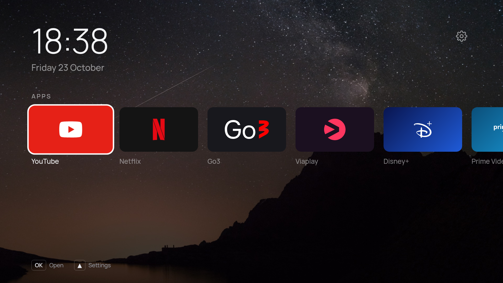

# TV Launcher

A quieter home screen for a Samsung Tizen TV: a clock, a row of your apps, a row of your consoles,
and nothing else.



*The browser preview, with the bundled Manrope font and the "Milky Way" wallpaper.*

A fork of Arnaud Etienne's Arn0 Launcher, adapted for a 2017 Samsung UE55MU6502 (Tizen 3.0):

- styling that works on the TV's much older web engine (no CSS variables, grid or flexbox `gap`)
- Manrope in static weights, with the Lithuanian letters
- the whole interface in English or Lithuanian
- tiles for this TV's apps, including Go3, Viaplay, Jellyfin, Rakuten TV and Fastlink TV
- a drawn hidden game, the stork run, in place of the original's personal one

The original's Home-button helpers are not included: they need .NET on the TV, which 2017 models
do not have. Open the launcher from the app list instead.

## Try the interface

Needs Node.js 20 or newer. Nothing is installed and no TV is involved. From a clone of this
repository:

```sh
npm run preview        # http://localhost:8080
```

Navigate with the arrow keys and Enter; Esc or Backspace is Back; `R` `G` `Y` `B` are the remote's
colour keys. `#all` and `#lab` in the URL open those screens directly.

The preview runs against [`src/js/tizen-mock.js`](src/js/tizen-mock.js), a stand-in for the Tizen
APIs that is inert on the TV itself; its app list mirrors this TV's. So the layout, focus behaviour,
settings, fonts and wallpapers are all real, while launching apps and switching HDMI inputs only do
something on a real TV.

## What you can change

Everything in [`src/js/config.js`](src/js/config.js) is meant to be edited: which apps appear, which
consoles and on which HDMI ports, how an input tile switches the TV, the locale, the starting
wallpaper. Most of it is also editable from the launcher's own Settings once it is on the TV, and
the TV's copy wins (`config.js` only supplies the defaults).

Beyond config: tile colours and brand marks in [`src/js/brands.js`](src/js/brands.js), the whole
look in [`src/css/style.css`](src/css/style.css), the interface text in
[`src/js/i18n.js`](src/js/i18n.js), and your own photos as wallpapers.

Anything specific to your own TV — its apps and consoles, weather coordinates, a devlog address —
belongs in `src/js/config.local.js` instead. That file is gitignored and merged over `config.js` one
level deep, so the tracked file keeps neutral defaults while the local one reaches both the browser
preview and the packaged `.wgt`. Nothing to strip before a push, nothing to restore before a build.
Copy [`config.local.example.js`](src/js/config.local.example.js) to start.

## Coding agent prompt

This project was largely built with coding agents, and adapting it is a reasonable thing to hand to
one. A starting prompt that keeps the agent on the safe side of the line:

```
This is a Tizen TV launcher (see README.md). Work in the browser preview only.

Do: edit src/js/config.js, src/js/brands.js and src/css/style.css; run `npm run preview`
and check the result; keep the 1920x1080 stage and remote-only navigation intact.

Do not: connect to a TV, run sdb, or sign or install a package.
```

## Put it on a TV

**[docs/setup-tv.md](docs/setup-tv.md)** — building the package and installing it with
Apps2Samsung. It installs as an ordinary app and uninstalling it removes it.

## Reference

### Commands

```sh
npm run preview      # browser preview on :8080
npm run build        # -> dist/tv-launcher.wgt
npm run devlog       # receive Lab logs from the TV into logs/tv.jsonl
node scripts/prepare-wallpapers.mjs <folder>   # regenerate wallpapers from your photos
```

### Remote

| Key | Action |
| --- | --- |
| Arrows | move (Up from the apps row reaches the gear = Settings) |
| OK | open app / switch input / select |
| Back | one level back (does nothing on Home) |

Hidden shortcuts: Red = All apps, Green = next wallpaper, Yellow (in All apps) = show system apps,
Blue = Lab. On Home, Left and Right alternating three times (◀ ▶ ◀ ▶ ◀ ▶) starts the hidden game, a stork
jumping hay bales and ducking crows; OK / Up jumps, Down ducks, Back returns Home. The code alternates rather than repeating a key
because a held remote key auto-repeats, which would both break a run-based code and fire it by
accident while sweeping along a row.

### Layout

```
src/                  everything that goes into the .wgt
  config.xml          Tizen manifest (app id, privileges)
  css/style.css       1920x1080 stage; performance rules measured, not assumed (see its header)
  fonts/              Manrope (OFL) in static weights with Lithuanian letters, bundled so nothing loads from the network
  img/marks/          brand marks (Simple Icons CC0, Custom Brand Icons MIT; see SOURCES.md)
  img/tiles/          marks recoloured per brand (generated at build)
  img/wallpapers/     1920x1080 wallpapers with the readability scrim baked in (generated)
  js/config.js        your apps, consoles, HDMI method, locale, theme
  js/config.local.js  gitignored per-TV overrides, merged over config.js (not in the repo)
  js/brands.js        tile colours and marks per brand
  js/apps.js          list / filter / launch via tizen.application
  js/inputs.js        HDMI via tizen.systeminfo + tizen.tvwindow
  js/wallpaper.js     wallpaper display and rotation
  js/screensaver.js   idle screen saver: photos, slow zoom, clock
  js/appearance.js    clock and date settings
  js/i18n.js          interface text in English or Lithuanian (the Lab screen stays English)
  js/weather.js       Open-Meteo reading for the screen saver corner
  js/prefs.js         settings saved on the TV
  js/ui.js            screens, focus, keys, toast, pop-up menu
  js/home.js          Home, All apps, Lab
  js/settings.js      Settings pages
  js/devlog.js        development log (Lab screen, optional upload to your computer)
  js/render-probe.js  measures what this TV can actually render (Lab screen only)
  js/platform-probe.js  reports which tizen.* / webapis.* APIs the TV exposes (Lab screen only)
  js/boot.js          start-up
  js/tizen-mock.js    fake Tizen APIs for the browser preview (inactive on the TV)
scripts/              build.sh, serve.mjs, devlog-server.mjs, fetch-assets.mjs, make-icon.mjs
docs/                 setup guide
```

### Settings

Saved on the TV in `localStorage`. They survive restarts and in-place updates, not an uninstall.

- **Background** — Off (plain gradient), one photo, or rotate: on each Home, 30 s, 5 min, 15 min,
  1 hour, daily.
- **Apps on Home** — OK on an app opens Move / Remove; OK on the right-hand slot adds one.
- **Consoles** — per console: rename (on-screen keyboard), HDMI port, logo, how it opens, hide,
  reorder, remove; plus add a console.
- **Appearance** — 24/12-hour clock, date shown/hidden, language (English, Lietuvių) for the whole
  interface, app names (always / when selected / never).
- **Navigation sound** — turn arrow-key sounds on or off, choose Soft, Warm or Bright, and preview
  the selected tone.
- **Screen saver** — on or off, start after 3/5/10/15 min idle on Home, photo change every
  60/75/90 s while Background is on Rotate, go dark after 30 min / 1 hour / 2 hours / never, and
  show it now.
- **Advanced** — refresh the app list, export settings to the log, reset everything, Lab.

### Wallpapers

Photos are cropped to 1920x1080 and darkened (top-left for the clock, bottom for the tiles) at
build time, so the TV only ever draws one plain JPEG on its own layer. Drop photos in a folder and
run `node scripts/prepare-wallpapers.mjs <folder>`; friendly names and crop positions for known
files live in that script. Current photos are from Unsplash; credits appear when you switch with
Green.

### Screen saver

After a few minutes with no input on Home it shows the wallpapers full screen with the clock, the
weather and the photo's name in the corners. Any button closes it, and that press does nothing else. It never
appears over a console input, another screen or the hidden game.

The weather is off until you put coordinates in `config.local.js` (see **What you can change**). It comes from
[Open-Meteo](https://open-meteo.com/), which needs no API key, and there is deliberately no
Settings page for it: the TV does not move, and coordinates are not something you type with a
remote. The reading is cached in `localStorage` so the screen saver opens with real numbers even
after the TV has been off, it refreshes at most once an hour and only when something is about to
show it, and anything older than three hours is treated as no reading at all — an unattended
screen should go blank rather than state yesterday's temperature as if it were now.

Everything in it moves, because a clock parked in one corner for an hour is a burn-in risk: the
photo drifts across 320 px while it is up and the next one drifts back the other way, the corner
text shifts a few pixels on each photo change, the clock moves to another corner every two and a
half minutes, and the whole thing fades to black once the configured hour is up. Photos follow the
**Background** setting — Rotate cycles them, a single photo is held, Off leaves just the clock —
using the screen saver's own position, so it never rewrites the wallpaper Home comes back to.

Black, rather than off, because a web app cannot turn this panel off: `tizen.power` and
`webapis.power` are both absent on the original's Q70B, which **Platform probe: what APIs this TV
exposes** in the Lab screen will confirm on yours. No privilege changes that — an absent API gives
you nothing to be refused by. A real power-off is the TV's own Eco Solution ▸ Auto Power Off,
driven by the same absence of remote input that started the screen saver.

Only `transform` and `opacity` animate, which the compositor can run without repainting. Not every
composited property is equal here, though, and only running it on the TV showed it: the first
version used a slow `scale()`, which this engine re-rasterises in visible steps rather than
compositing, and it stepped badly enough to be unpleasant to watch. A `translate()` of the same
layer is smooth, so the photo pans instead of zooming and the layer is laid out 320×180 larger
than the screen to give it room. The Lab probe cannot settle this one: it times a JavaScript
repaint loop, and a transition that runs off the main thread reads as a clean 60 fps there whether
or not the panel keeps up. Judge it by eye on the TV.

### Apps

`getAppsInfo` reports many internal services as visible, so **All apps** keeps only ids that look
like store apps (`AbCdEfGhIj.Name`, or numeric) plus a short list of preinstalled consumer apps, and
drops names containing service/worker/agent/e-manual. Yellow shows everything when you need to find
something. When two apps share a name (this TV lists a broken Netflix alias beside the real one),
All apps shows one, preferring the built-in entry over the store-format one; Yellow shows both. To
pin an exact app, put its id in `config.local.js` as `{ id: '...' }`; Lab ▸ **Send installed app
list to log** lists them.

### HDMI inputs

`tizen.systeminfo.getPropertyValue('VIDEOSOURCE')` lists the ports and `tizen.tvwindow.setSource()`
changes the source (privilege `tv.window`, public). What happens next is undocumented, so
`inputMethod` has three options:

- `switch+viewer` (default) — set the source, then open Samsung's TV viewer, so the console is shown
  by the TV itself with Game Mode and friends as usual.
- `switch` — only set the source.
- `inapp` — show the input full screen inside the launcher; Back returns to the dashboard. Probably
  no automatic Game Mode or VRR this way.

The **Lab** screen (Blue) tries each method per console and reports what happened. The dot on each
tile is green when the TV reports that port as connected.

To collect Lab results on your computer, point `devLogUrl` in `config.local.js` at it and run
`npm run devlog`; entries land in `logs/tv.jsonl`. Set it to `null` to disable, which is the
sensible setting for a TV you are not actively debugging.

### What the hardware can afford

The TV will not tell you what it can render, so the Lab screen measures it. **Render probe:
everything** walks a focus ring along eight tiles — the same work as moving along the apps row —
and counts frames against the wall clock for each of four stages. Results land in the log.

On the original's Q70B (Chromium 85, 4 cores, 2 GB), baseline is 59.5 fps / 16.8 ms with no
dropped frames, and:

| | Measured | |
| --- | --- | --- |
| Blurred `box-shadow`, 8 tiles at `0 40px 100px` | 59.5 fps, 0 dropped | free |
| 3 live radial-gradient layers, 1100 px | 4.6 fps, 178.7 ms, 88/90 dropped | never at runtime |

So soft shadows are fine and background glows are not. Bake a gradient into the wallpaper at
build time instead — `scripts/prepare-wallpapers.mjs` already does exactly this for the
readability scrim.

The probe also reports the engine and its CSS support, which saves guessing: Chromium 85 has
grid, gap, sticky and `clamp()`, but no `inset`, `aspect-ratio`, `overflow: clip`, individual
transform properties, `color-mix()`, container queries or `:has()`.

None of this has been measured on the UE55MU6502 yet. Re-run it on your own TV before trusting
any of these numbers; that is the whole point of it. Two early runs on the Q70B produced nonsense — `requestAnimationFrame` on this engine stops
tracking vsync and fires callbacks in batches, which reads as absurdly high frame rates, so the
probe now measures against `Date.now()` and flags any sample faster than the panel refreshes.

### Privileges

| Privilege | Used for |
| --- | --- |
| `application.launch` | opening apps and the TV viewer |
| `application.info` | listing apps |
| `tv.inputdevice` | colour keys (arrows, OK and Back need no registration) |
| `tv.window` | HDMI source switching and display |
| `internet` + `<access origin="*">` | the Open-Meteo request and the development log |

## Licence and credits

MIT — see [LICENSE](LICENSE); the original code and documentation are Arnaud Etienne's. Bundled fonts (OFL), Unsplash
photos and brand marks keep their own terms. Weather data by [Open-Meteo](https://open-meteo.com/),
used under its non-commercial licence. Brand names and logos belong to their owners.

This project is independent and is not affiliated with Samsung or any streaming service.
